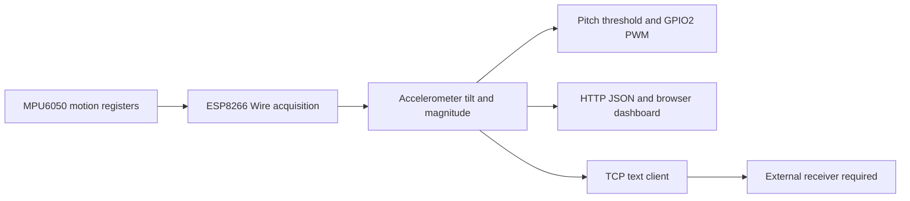

# Wearable Posture Sensing

ESP8266 + MPU6050 的服饰原型资料，以及倾角估计、LED 反馈和无线遥测固件。

**简体中文** · [English](README_EN.md) · [日本語](README_JA.md)

**深入阅读：** [技术说明](docs/technical-notes.zh-CN.md) · [部署与操作](docs/setup.zh-CN.md)

项目探索把无线节点与惯性传感器安装到织物服饰上，通过 LED 和网络页面呈现倾斜状态。实物照片、课程原始实验程序与后来归档的综合固件分开说明：当前综合固件已通过本机编译，但没有据此认定它就是当年实机演示烧录的版本。

## 项目与证据范围

| 材料 | 可以确认的内容 | 验证边界 |
| --- | --- | --- |
| 服饰与节点照片 | ESP-12F 圆形节点、MPU6050 模块及服饰安装形态 | 不能证明材料成分、耐洗性、PCB自主设计或算法精度 |
| 三个课程实验程序 | 点灯、线性 PWM、Wi-Fi/IMU 初始化与 TCP 读写尝试 | 有拼写及连接缺口，不是完整姿态系统 |
| `wearable_posture_node.ino` | 加速度倾角、GPIO2 PWM、HTTP JSON、TCP 文本发送 | 2026-09-15 加入仓库；本次编译通过，未做硬件运行验证 |

工程价值在于传感采集、服饰安装、嵌入式交互和多接口集成，不以未实现的融合算法或未经测量的精度指标支撑。

## 当前固件的数据流



`getMotion6()` 读出六轴原始量，但当前倾角只使用加速度计；陀螺仪读数未参与融合。HTTP 页面和 LED 使用不同的判断条件，见[技术说明](docs/technical-notes.zh-CN.md#feedback)。

## 已实现的软件内容

- GPIO4/5 的 `Wire` 采集，请求总线时钟 400 kHz；静态重力倾角与合加速度。
- GPIO2 低有效 PWM：正常时线性增减亮度，俯仰角越界时切换亮灭。
- SoftAP + Station、HTTP `/` 页面与 `/api/data` JSON；浏览器设定每 200 ms 轮询。
- 向外部主机发送 `PKT:P=...,R=...,A=...` 文本，发送检查间隔为 100 ms。

这些是代码路径和设定间隔，并非已实测的刷新率、传输延迟或稳定采样率。没有互补滤波、航向角/位置轨迹、应变桥采集或医学诊断算法。

## 服饰原型


照片展示服饰上的圆形 ESP-12F 板和外接惯性传感器。导电缝线是互连探索，不等同于已经实现电阻式应变传感。更多实物及资料边界见[技术说明](docs/technical-notes.zh-CN.md#hardware)。

## 目录与复现

```text
src/firmware/
  wearable_posture_node.ino
  examples/
    sketch_mar12a1_blink.ino
    sketch_mar19a2_pwm.ino
    sketch_mar26a_tcp_imu.ino
docs/
  images/
  technical-notes.*.md
  setup.*.md
LICENSE
```

[部署说明](docs/setup.zh-CN.md) 包含草图目录规则、已编译依赖、引脚、网络和单独的历史示例限制。综合固件与三个示例必须分别打开，不应合并为一个 Arduino 草图。

## 验证、贡献与局限

2026-10-23 使用 ESP8266 core 3.1.2、MPU6050 1.4.5、`esp8266:esp8266:generic` 编译综合固件成功，依赖中存在宏重定义警告。未烧录、未连接 IMU、未验证 TCP 接收或人体姿态准确率。

课程团队实物与后补固件的贡献、确切电池/电源芯片、原始 PCB 设计和当年运行程序仍需原始证据。后续应先统一阈值、处理故障/阻塞、完成标定与实测，再研究姿态融合。代码许可见 [LICENSE](LICENSE)；外部课程图片及器件图不因本仓库许可自动转授。
