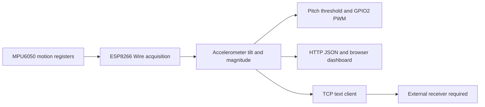

# Wearable Posture Sensing

An ESP8266/MPU6050 garment prototype archive with tilt estimation, LED feedback, and wireless telemetry firmware.

[简体中文](README.md) · **English** · [日本語](README_JA.md)

**Explore：** [Technical notes](docs/technical-notes.en.md) · [Setup and operation](docs/setup.en.md)

This project explores attaching wireless and inertial-sensing hardware to clothing and presenting tilt through LEDs and a browser. Hardware photos, original course sketches, and a later integrated firmware revision are distinguished. The integrated firmware compiles locally; this does not establish that it was the firmware used in the original physical demonstration.

## Project and evidence scope

| Material | Supported content | Evidence boundary |
| --- | --- | --- |
| Garment and node photos | Circular ESP-12F node, MPU6050 module, garment mounting | Not proof of yarn composition, washability, original PCB design, or angle accuracy |
| Three original sketches | Blink, linear PWM, Wi-Fi/IMU initialization, attempted TCP I/O | Typo and connection gaps; not an integrated posture system |
| `wearable_posture_node.ino` | Accelerometer tilt, GPIO2 PWM, HTTP JSON, TCP text | Added on 2026-09-15; compiled in this review, not hardware-tested |

The engineering content is sensing, garment mounting, embedded interaction, and interface integration. Unimplemented fusion algorithms and unmeasured accuracy are not used as results.

## Current firmware data flow



`getMotion6()` reads six raw channels, but tilt uses accelerometer data only; gyro readings do not enter a fusion algorithm. Browser and LED thresholds differ, as explained in the [technical notes](docs/technical-notes.en.md#feedback).

## Implemented software paths

- `Wire` acquisition on GPIO4/5 with a requested 400 kHz bus clock; static-gravity tilt and acceleration magnitude.
- Active-low GPIO2 PWM: linear brightness steps normally and on/off switching above the pitch threshold.
- SoftAP + Station, HTTP `/` and `/api/data`; a browser polling timer configured for 200 ms.
- `PKT:P=...,R=...,A=...` text to an external host, with a 100 ms send-check interval.

These describe code paths and configured intervals, not measured refresh rates, latency, or stable sampling rates. Complementary filtering, yaw/position trajectories, strain-bridge acquisition, and clinical diagnosis are absent.

## Garment prototype


The photo shows a circular ESP-12F board and external inertial module on clothing. Conductive stitching explores interconnection; it is not evidence of implemented resistive strain sensing. See [hardware evidence](docs/technical-notes.en.md#hardware).

## Layout and reproduction

```text
src/firmware/
  wearable_posture_node.ino
  examples/
    sketch_mar12a1_blink.ino
    sketch_mar19a2_pwm.ino
    sketch_mar26a_tcp_imu.ino
docs/
  images/
  technical-notes.*.md
  setup.*.md
LICENSE
```

The [setup guide](docs/setup.en.md) covers sketch naming, the compiled dependencies, pins, networking, and limitations of each historical example. Open the integrated firmware and the three examples separately, not as one Arduino sketch.

## Verification and limits

On 2026-10-23, the integrated firmware compiled with ESP8266 core 3.1.2, MPU6050 1.4.5, and `esp8266:esp8266:generic`. Dependency macro-redefinition warnings remain. No flashing, live IMU access, TCP reception, or human-posture accuracy test was performed.

Individual contributions to the course hardware and later firmware, exact battery/power ICs, original PCB design, and the historical deployed firmware remain unverified. Unify thresholds, handle faults/blocking, and calibrate/test before investigating fusion. See [LICENSE](LICENSE); course and component images require their own rights/provenance checks.
