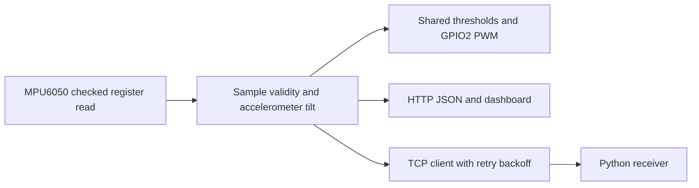

# Wearable Posture Sensing

Garment-mounted ESP8266 / MPU6050 prototype material and later tilt, LED, and network telemetry firmware. Historical hardware, course sketches, and the 2026 integrated firmware are documented separately; successful compilation does not establish historical deployment.

[简体中文](README.md) · **English** · [日本語](README_JA.md)

[Technical notes](docs/technical-notes.en.md) · [Setup](docs/setup.en.md)

## Evidence and implementation scope

| Material | Confirmed content | Boundary |
| --- | --- | --- |
| Hardware photographs | Circular ESP-12F node, MPU6050, garment mounting | No proof of material performance, original PCB design, or angle accuracy |
| Three course sketches | Blink, linear PWM, Wi-Fi/IMU initialization and greeting | Spelling, PWM setup, and connection logic repaired on 2026-10-23; not a complete posture system |
| Integrated firmware | Accelerometer tilt, shared thresholds, LED, HTTP, TCP | First archived on 2026-09-15; current maintenance does not establish deployment in 2024 |

## Data flow



## Implemented software

- GPIO4/5 software TWI requests 400 kHz; checked 14-byte IMU reads and 2 s recovery retries.
- LED and page share absolute pitch >30° or roll >35°; invalid samples turn the LED off and show unavailable data.
- Active-low GPIO2 PWM with clamped state and reset on mode changes; 25 ms normal steps and 50 ms alert toggles.
- AP+STA, HTTP dashboard, and validity/sample-age JSON; polling waits 200 ms after completion and clears healthy status on failure.
- Valid TCP samples are attempted at least 100 ms apart, with 2 s reconnect backoff; a Python receiver is included.

## Garment prototype


## Layout and reproduction

```text
src/firmware/
  wearable_posture_node.ino
  posture_logic.h
  network_config.example.h
  examples/                    # separate sketches + tcp_config.example.h
tools/telemetry_receiver.py
tests/
docs/                          # images, technical-notes.*, setup.*
```

[Setup](docs/setup.en.md)

## Verification and limitations

On 2026-10-23 the integrated sketch and all three separate examples compiled with ESP8266 core 3.1.2 and MPU6050 1.4.5. Seven feedback, seven mocked-browser, and three packet-parser cases passed. No flashing, physical IMU, wireless link, timing, power, or human angle-accuracy test was performed. Dependency macro-redefinition warnings remain.

Tilt uses acceleration only: no sensor fusion, yaw/trajectory, strain acquisition, or medical diagnosis. Calibration, physical fault recovery, and timing measurements remain next steps. Exact personal/team ownership, deployed historical firmware, materials, and power hardware require original records. See [LICENSE](LICENSE) for code; third-party images and component material are not automatically relicensed.
