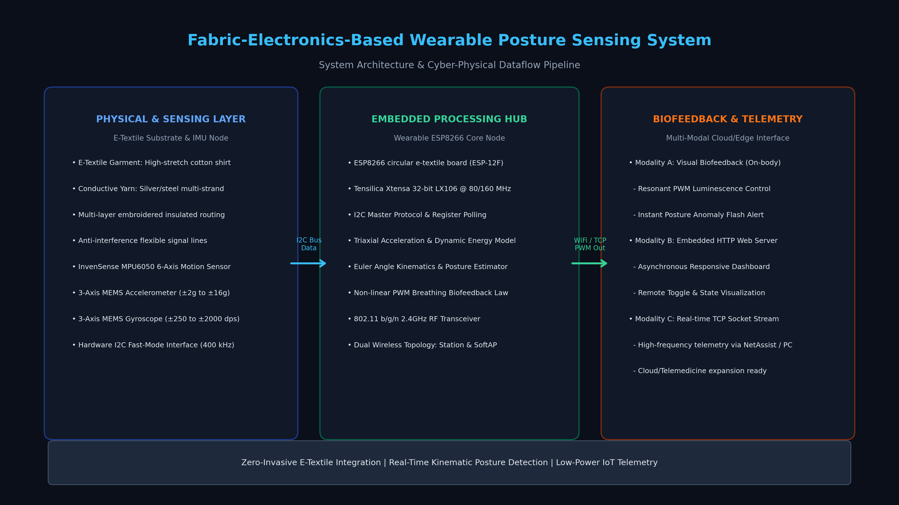
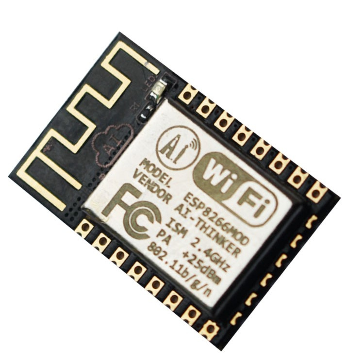

# Fabric-Electronics-Based Wearable Posture Sensing & Wireless Biofeedback System

<div align="center">

[](LICENSE)
[](https://www.espressif.com/)
[](https://invensense.tdk.com/)
[](docs/)
[](src/)

[**中文文档**](README.md) | [**English**](README_EN.md) | [**日本語**](README_JA.md)

</div>

---

## 1. Project Overview

The **Fabric-Electronics-Based Wearable Posture Sensing & Wireless Biofeedback System** is an advanced smart healthcare and human-machine interface (HMI) solution designed to deliver non-invasive spinal posture tracking, biomechanical analysis, and active closed-loop biofeedback.

Conventional rigid wearable devices suffer from poor skin conformity, wearer discomfort, and high mechanical failure rates along soldered interconnections. This project overcomes these limitations by integrating **multi-strand stainless-steel and silver-plated conductive yarn** directly into a 100% natural cotton garment substrate. Utilizing precision textile embroidery and cross-layer insulation techniques, the conductive yarn serves as a zero-burden, flexible micro-bus connecting the central embedded microcontroller with spatial inertial sensors.

At the core of the system lies a 32-bit **Espressif ESP8266 (ESP-12F) Xtensa microcontroller** interfaced with an **InvenSense MPU-6050 6-axis MotionTracking sensor** (3-axis MEMS accelerometer and 3-axis MEMS gyroscope). By executing real-time discrete complementary filtering and dynamic kinetic energy metrics at the edge, the system accurately detects forward inclination (slumping/kyphosis) and lateral spinal tilt (scoliosis). Real-time interventions are delivered through dual channels: on-body non-linear pulse-width modulated (PWM) optical biofeedback and high-throughput wireless telemetry via an embedded HTTP web server and TCP socket streaming.

---

## 2. Visual Showcase & Hardware Implementation

<div align="center">

| System Architecture & Cyber-Physical Dataflow | E-Textile Garment & Circular Wearable Processing Node |
| :---: | :---: |
|  |  |
| **MPU6050 Spatial Inertial Node & Textile Wiring** | **Circular Wearable ESP8266 Microcontroller Hub** |
|  |  |

</div>

---

## 3. Mathematical Formulations & Biomechanical Modeling

Rigorous physical and mathematical formulations are deployed within the edge firmware and telemetry clients to govern strain-resistance transduction, spatial attitude estimation, dynamic kinetic energy quantification, and visual psycho-perceptual feedback.

### 3.1 Conductive Yarn Piezoresistive Strain Model & Wheatstone Bridge Signal Conditioning

As the textile garment deforms under trunk movement, conductive yarn threads experience structural elongation and contact resistance variations. Given an initial unconstrained resistance $R_0$, mechanical strain $\varepsilon = \frac{\Delta L}{L_0}$, and gauge factor $G_F$, the piezoresistive behavior satisfies:

$$
R(\varepsilon) = R_0 (1 + G_F \cdot \varepsilon)
$$

To extract micro-strain signals with common-mode noise rejection, a symmetric Wheatstone bridge circuit is implemented. The bridge output differential voltage equation is:

$$
V_{\text{out}} = V_{\text{in}} \left( \frac{R_2}{R_1 + R_2} - \frac{R_x(\varepsilon)}{R_3 + R_x(\varepsilon)} \right)
$$

Assuming a balanced baseline condition $$R_1 = R_2 = R_3 = R_0$$, the first-order linearized relationship with respect to mechanical strain is given by:

$$
V_{\text{out}} \approx \frac{V_{\text{in}}}{4} \cdot G_F \cdot \varepsilon
$$

### 3.2 Spatial Euler Posture Angle Derivation from Gravitational Vectors

Let the normalized gravitational acceleration vector acquired by the triaxial MEMS accelerometer be represented as $$\mathbf{a} = [a_x, a_y, a_z]^{\top}$$. Based on rigid-body kinematics, the pitch angle $\theta$ (forward spinal inclination) and roll angle $\phi$ (lateral spinal tilting) are analytically derived as:

Pitch Angle $\theta$ (sagittal plane inclination):

$$
\theta = \arctan \left( \frac{-a_x}{\sqrt{a_y^2 + a_z^2}} \right) \cdot \frac{180^\circ}{\pi}
$$

Roll Angle $\phi$ (coronal plane inclination):

$$
\phi = \arctan \left( \frac{a_y}{a_z} \right) \cdot \frac{180^\circ}{\pi}
$$

### 3.3 Discrete Complementary Filtering for Multi-Axis Sensor Fusion

To eliminate high-frequency mechanical vibrations from accelerometer readouts while compensating for low-frequency integration drift in gyroscope outputs, a discrete-time complementary filter is computed at sample interval $\Delta t$:

$$
\theta_t = \alpha (\theta_{t-1} + \omega_{\text{gyro}} \cdot \Delta t) + (1 - \alpha) \theta_{\text{acc}}
$$

where the smoothing decay weighting factor $\alpha$ is parameterized by system time constant $\tau$:

$$
\alpha = \frac{\tau}{\tau + \Delta t}, \quad (0.95 \le \alpha \le 0.98)
$$

### 3.4 3D Euclidean Acceleration Magnitude & Dynamic Motion Kinetic Energy Metric

To distinguish quasi-static postural states from dynamic ambulatory activities, the Euclidean norm of total acceleration $|\mathbf{a}|$ is evaluated:

$$
|\mathbf{a}| = \sqrt{a_x^2 + a_y^2 + a_z^2}
$$

Within an observation epoch $$t \in [t_0, t_0 + T]$$, removing static gravitational acceleration $\mathbf{g}$ yields the instantaneous dynamic kinetic energy integral of the wearer's torso:

$$
E_{\text{kinetic}} = \frac{1}{2} m \int_{t_0}^{t_0 + T} \left\| \mathbf{a}(t) - \mathbf{g} \right\|^2 \, dt
$$

When $|\mathbf{a}| \approx 1.0g$, posture anomaly detection operates at maximum sensitivity. During vigorous movements, thresholding logic dynamically suppresses false positive alerts.

### 3.5 Weber-Fechner Non-Linear Visual Respiration Biofeedback Law

To accommodate human visual psycho-perceptual non-linearities, the PWM illumination duty ratio $D(t)$ is governed by a power-law corrected sinusoidal trajectory:

$$
D(t) = D_{\min} + (D_{\max} - D_{\min}) \cdot \left[ \frac{1}{2} \left( 1 + \sin \left( \frac{2\pi t}{T_{\text{breath}}} - \frac{\pi}{2} \right) \right) \right]^\gamma
$$

where breathing cycle period $T_{\text{breath}} = 3.0\text{ s}$ and empirical gamma coefficient $\gamma = 2.2$. When postural deviation exceeds critical limits $|\theta| > \theta_{\text{threshold}}$, the biofeedback controller switches instantaneously to high-frequency strobe alarm mode ($f = 10\text{ Hz}$).

---

## 4. Hardware & Software Specifications

| Subsystem | Component / Technology | Specification Details |
| :--- | :--- | :--- |
| **Core Microcontroller** | Espressif ESP8266 (ESP-12F) | Tensilica 32-bit LX106 @ 80/160MHz, 4MB SPI Flash |
| **Inertial Sensor** | InvenSense MPU-6050 | 3-axis accelerometer ($\pm 2g$), 3-axis gyroscope ($\pm 250^\circ/s$), 16-bit ADC |
| **Bus Interface** | Hardware I2C Fast-Mode | Bus frequency $f_{\text{SCL}} = 400\text{ kHz}$, polling cycle $10\text{ ms}$ |
| **E-Textile Interconnect** | Micro-fine conductive yarn | $0.2\text{ mm}$ diameter, $< 1.5\,\Omega/\text{cm}$ line impedance, flexible insulation |
| **RF / Wireless Stack** | 802.11 b/g/n Wi-Fi | Dual SoftAP + Station support, embedded WebServer & TCP socket |
| **Biofeedback Modality** | Non-linear PWM Optical Indicator | 10-bit resolution ($0 \sim 1023$), calm breathing vs stroboscopic alert |
| **Telemetry Interface** | Embedded Web Dashboard & TCP | Real-time JSON telemetry stream ($5\text{ Hz}$), responsive browser UI |

---

## 5. Repository Layout

```text
Fabric-Electronics-Based-Wearable-Posture-Sensing-System/
├── docs/
│   └── images/
│       ├── system_architecture.png       # Comprehensive system dataflow architecture
│       ├── demo_e_textile_garment.jpg    # E-textile garment & circular hub photo (1920x1280)
│       ├── demo_sensing_node.jpg         # Close-up of MPU6050 sensing node & stitching (1920x1280)
│       ├── hardware_esp8266.jpg          # Circular wearable ESP8266 board photograph
│       └── hardware_mpu6050.jpg          # MPU6050 sensor module close-up photo
├── src/
│   └── firmware/
│       ├── wearable_posture_node.ino     # Full production embedded firmware (I2C+Filter+Web+TCP)
│       └── examples/
│           ├── sketch_mar26a_tcp_imu.ino # Baseline TCP communication & IMU validation
│           ├── sketch_mar19a2_pwm.ino    # Non-linear respiration PWM illumination routine
│           └── sketch_mar12a1_blink.ino  # Initial hardware connectivity test routine
├── LICENSE                               # Official MIT License
├── README.md                             # Chinese Documentation & Technical Breakdown
├── README_EN.md                          # English Engineering Specification
└── README_JA.md                          # Japanese Academic & Industrial Portfolio
```

---

## 6. Build, Deployment & Quick Start

### 6.1 Hardware Pin Mapping

| ESP8266 Pin | Textile Routing Net | MPU6050 Pin | Functional Role |
| :---: | :---: | :---: | :---: |
| **3V3** | Conductive Yarn VCC Bus | VCC | 3.3V Regulated System Power Supply |
| **GND** | Conductive Yarn GND Bus | GND | Common Circuit Reference Ground |
| **GPIO4 (D2)** | Conductive Yarn SDA Net | SDA | I2C Bidirectional Serial Data Line |
| **GPIO5 (D1)** | Conductive Yarn SCL Net | SCL | I2C Serial Clock Line ($400\text{ kHz}$) |
| **GPIO2 (D4)** | Onboard / E-Textile LED | - | Non-linear Visual Biofeedback Indicator |

### 6.2 Firmware Compilation & Flashing

1. In the **Arduino IDE**, install the official ESP8266 board manager package:
   ```text
   http://arduino.esp8266.com/stable/package_esp8266com_index.json
   ```
2. Install library dependencies: `MPU6050` (by Electronic Cats), `I2Cdev`, `ESP8266WiFi`.
3. Open `src/firmware/wearable_posture_node.ino`.
4. Under `Tools` $\rightarrow$ `Board`, select `Generic ESP8266 Module` (or `NodeMCU 1.0`), set baud rate to `115200`, and click **Upload**.

### 6.3 Wireless Telemetry & Web Dashboard

1. Power the wearable node; the system initializes an autonomous Wi-Fi access point: `Posture_Garment_Node`.
2. Connect client device to the hotspot (Password: `12345678`).
3. Launch any modern browser and navigate to `http://192.168.4.1`.
4. The dashboard streams real-time pitch, roll, dynamic acceleration, and postural safety classifications at $5\text{ Hz}$.

---

## 7. License

This repository is distributed under the open-source **MIT License**. Refer to the [LICENSE](LICENSE) file for complete details.
