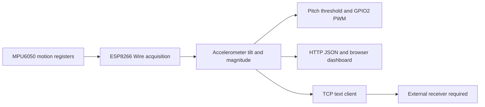
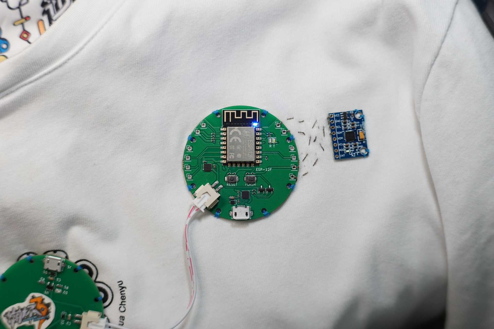

# Wearable Posture Sensing

ESP8266・MPU6050 を使う衣服試作資料と、傾斜角推定、LEDフィードバック、無線テレメトリのファームウェア。

[简体中文](README.md) · [English](README_EN.md) · **日本語**

**詳細：** [技術ノート](docs/technical-notes.ja.md) · [導入と操作](docs/setup.ja.md)

無線ノードと慣性センサを衣服へ取り付け、LEDとブラウザで傾きを示す試作です。実物写真、演習当時のスケッチ、後から追加された統合ファームウェアを区別します。統合版は今回コンパイルできましたが、当時の実機デモで使用した版との一致は確認できていません。

## プロジェクトと根拠の範囲

| 資料 | 確認できる内容 | 確認できない点 |
| --- | --- | --- |
| 衣服・ノード写真 | ESP-12F円形ノード、MPU6050、衣服への取り付け | 糸の組成、洗濯耐性、PCB独自設計、角度精度 |
| 演習の3スケッチ | 点灯、線形PWM、Wi-Fi/IMU初期化、TCP入出力の試行 | 誤記と接続不足があり、統合姿勢システムではない |
| `wearable_posture_node.ino` | 加速度による傾斜、GPIO2 PWM、HTTP JSON、TCPテキスト | 2026-09-15追加。今回コンパイル済み、実機未検証 |

価値はセンシング、衣服への取り付け、組み込み操作、複数インターフェースの統合にあります。未実装のセンサ融合や未測定の精度は成果に含めません。

## 現行ファームウェアのデータ経路



`getMotion6()` は6軸を読みますが、傾斜角は加速度のみで計算し、ジャイロ値を融合しません。LEDとブラウザの判定条件も異なります。[技術ノート](docs/technical-notes.ja.md#feedback) を参照してください。

## 実装されているソフトウェア

- GPIO4/5の `Wire` 取得。バスクロック設定400 kHz、静的重力による傾斜角と合成加速度。
- GPIO2のアクティブLOW PWM。通常時は線形増減、ピッチしきい値超過時は点滅。
- SoftAP + Station、HTTP `/` と `/api/data`。ブラウザのポーリング設定は200 ms。
- 外部ホストへの `PKT:P=...,R=...,A=...` 送信。送信可否の確認間隔は100 ms。

これらはコードの処理と設定間隔で、実測の更新率・遅延・安定サンプリング周波数ではありません。相補フィルタ、ヨー・位置軌跡、ひずみブリッジ取得、医療診断はありません。

## 衣服試作



円形ESP-12F基板と外付け慣性センサを衣服に取り付けた写真です。導電糸による接続の試行と、抵抗式ひずみセンサの実装は別です。[実物資料の範囲](docs/technical-notes.ja.md#hardware) も参照してください。

## 構成と再現

```text
src/firmware/
  wearable_posture_node.ino
  examples/
    sketch_mar12a1_blink.ino
    sketch_mar19a2_pwm.ino
    sketch_mar26a_tcp_imu.ino
docs/
  images/
  technical-notes.*.md
  setup.*.md
LICENSE
```

[導入手順](docs/setup.ja.md) にスケッチ名、コンパイル済み依存関係、ピン、ネットワーク、各旧例の制約を記載しています。統合版と3例は別々に開き、一つのArduinoスケッチへ混在させないでください。

## 検証・担当・制約

2026-10-23に ESP8266 core 3.1.2、MPU6050 1.4.5、`esp8266:esp8266:generic` で統合版のコンパイルに成功しました。依存ライブラリのマクロ再定義警告は残ります。書き込み、実IMU、TCP受信、人体姿勢の精度試験は行っていません。

演習ハードウェアと後補ファームウェアの個人分担、電池・電源IC、元のPCB設計、当時の稼働版は未確認です。判定の統一、障害・ブロッキング処理、校正と実測を先行し、その後に融合を検討します。[LICENSE](LICENSE) は外部の演習・部品画像の権利を自動的に移転するものではありません。
