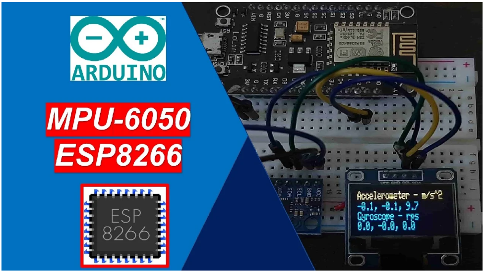
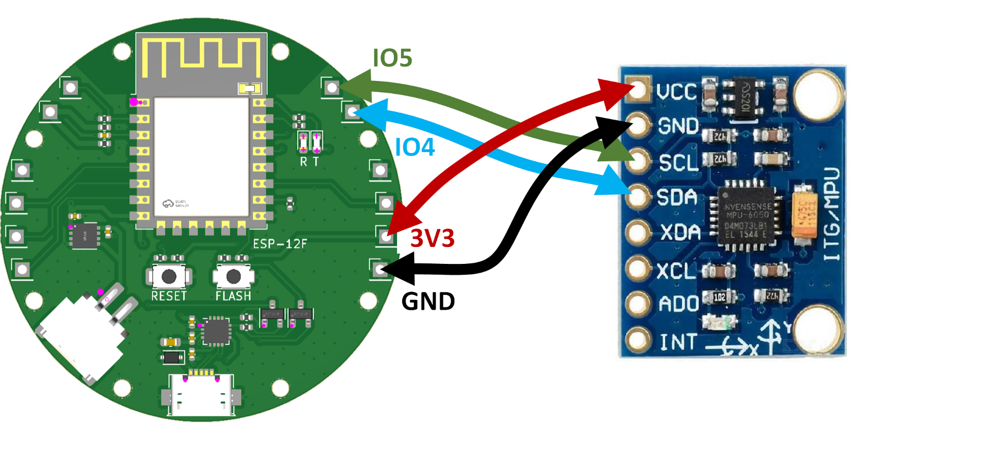
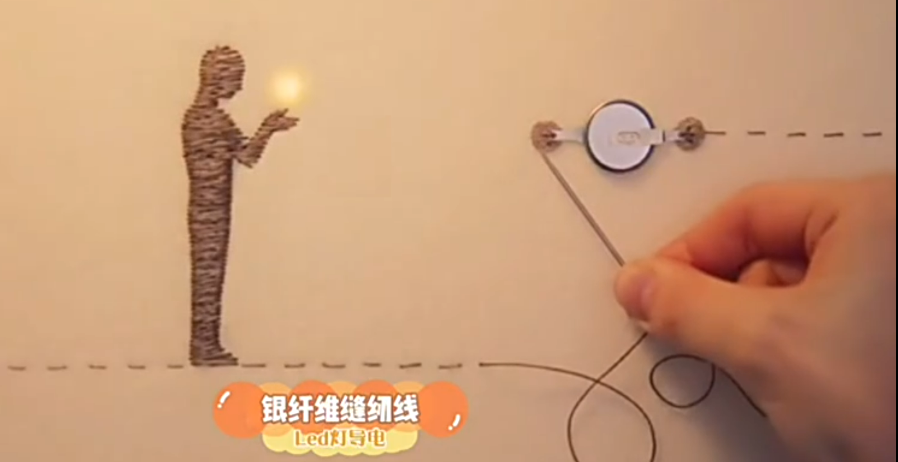
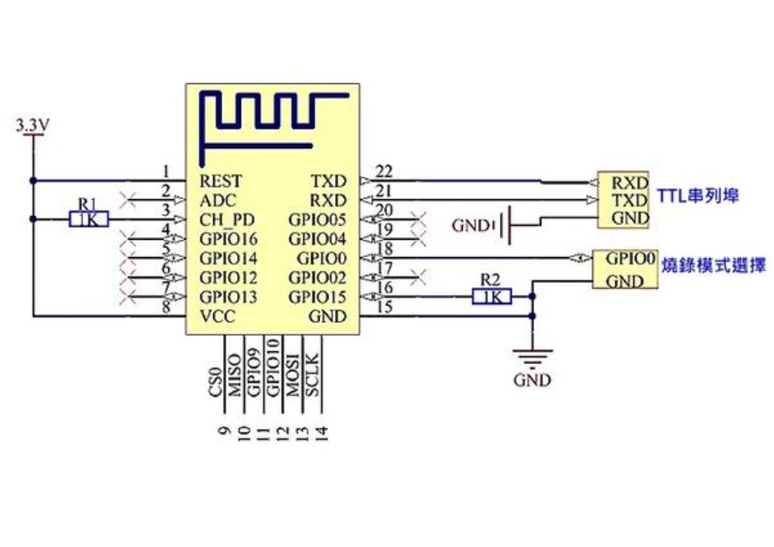
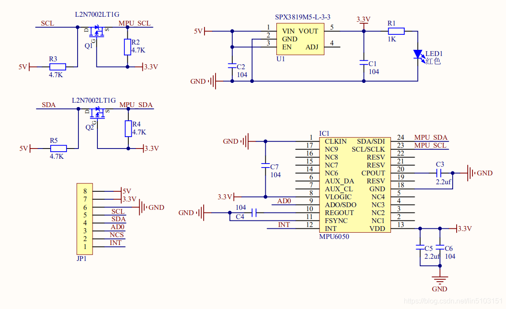
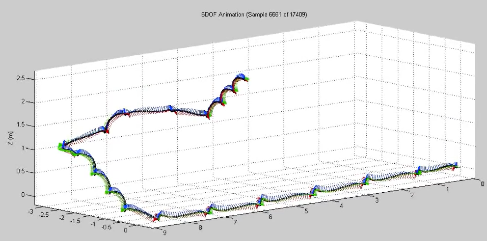
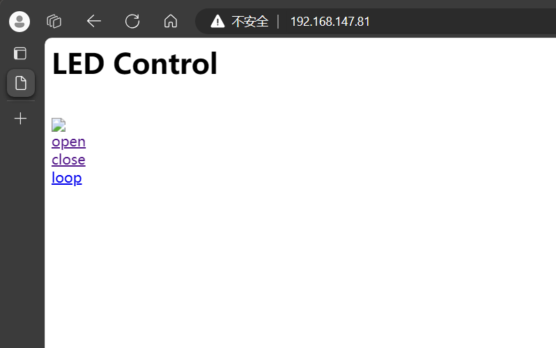
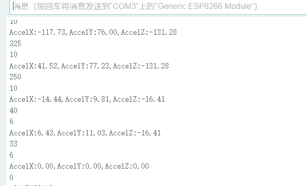

# 織物エレクトロニクスとスマートウェアに基づくウェアラブル姿勢検知＆生体フィードバックシステム
# Fabric-Electronics-Based Wearable Posture Sensing & Wireless Biofeedback System

<div align="center">

[](LICENSE)
[](https://www.espressif.com/)
[](https://invensense.tdk.com/)
[](docs/)
[](src/)
[](https://www.uestc.edu.cn/)

[**中文文档**](README.md) | [**English**](README_EN.md) | [**日本語**](README_JA.md)

</div>

---

## 1. プロジェクト背景と学術的沿革 (Academic Heritage & Background)

本プロジェクトは、**電子科技大学（UESTC）自動化工程学院**の学部1年次後期における実践的コアカリキュラム——**「新入生プロジェクト演習：ウェアラブルコンピューティングシステム設計」（第3班）**の研究開発成果です。

デスクワークや長時間の着座学習に伴い、現代人における頸椎症、側弯症、猫背などの不良姿勢が深刻な健康課題となっています。しかし、従来の市販姿勢モニタリング装置の多くは、硬質プラスチック筐体とゴムバンド・剛性配線ハーネスを採用しており、**皮膚への追従性の欠如、顕著な異物感や圧迫感、身体の屈伸に伴う配線の金属疲労断線**といった重大な欠点を抱えていました。

これらの課題を解決するため、本プロジェクトでは最先端の**織物エレクトロニクス（E-Textiles / 電子テキスタイル）**と**ウェアラブルエッジコンピューティング**を融合しました：
- 硬質な金属ワイヤを完全に排除し、**マイクロスケールの銀メッキ極細導電糸（Silver Conductive Yarn）**を採用。高精度な刺繍技術により、日常の綿衣服繊維内部に低インピーダンスの電気回路バスを直接織り込み；
- 外周に複数の同心円状リング縫製電極パッドを配置した低背型**円形ウェアラブルPCBノード**を独自開発。針糸による強固な機械的縫着と、身体運動に伴う歪みの分散緩和を実現；
- 脊柱の重要な力学節点に **InvenSense MPU-6050 6軸慣性計測ユニット（IMU）** を配置し、低消費電力な **Espressif ESP8266 32ビットマイコン** 上で相補フィルタ姿勢推定アルゴリズムをリアルタイム実行；
- 「**身体動作計測 — 柔軟テキスタイル伝送 — エッジ相補フィルタリング — 非線形光学フィードバック — 無線マルチ端末テレメトリ**」をシームレスに統合した、完全クローズドループのスマートヘルスケア衣服システムを構築しました。

---

## 2. 実機写真とシステムアーキテクチャ (Hardware & System Showcase)

### 2.1 スマートテキスタイル衣服実物と動作状態 (Physical Wearable Artifacts)

<div align="center">

| スマートテキスタイル衣服と円形主制御ノードの縫製実物 | 柔軟デュアルノード動作状態と導電糸刺繍配線のクローズアップ |
| :---: | :---: |
|  |  |
| **衣服縫製実機**：円形ESP8266主制御基板とMPU-6050センサが銀導電糸により綿Tシャツへ一体刺繍配置 | **デュアルノード点灯状態**：リチウム電池管理ノードと主制御ノードが柔軟配線で接続され、リアルタイム生体フィードバックLEDが発光 |

| ウェアラブル検知ノードの近接特写 | ブレッドボード初期回路検証プロトタイプ |
| :---: | :---: |
|  |  |
| **ノード近接写真**：オンボードMicro-USB充電・デバッグポート、ステータスLED、超小型リセットスイッチ | **初期回路検証**：ESP8266 + MPU6050 + OLEDディスプレイによるブレッドボード上での6軸運動学タイミング較正 |

</div>

### 2.2 システム全体トポロジとエンドツーエンドデータフロー (System Architecture & Data Flow)

システムは、最下層の物理テキスタイルから最上位のマルチ端末可視化テレメトリに至るまで、堅牢なデータパイプラインを形成しています：

<div align="center">

</div>

1. **柔軟物理センシング層 (Textile & Sensing Layer)**：人体の脊柱運動変位が布地の伸縮歪み及びMPU-6050内部の静電容量型MEMS微細構造を変調させ、16ビット高精度3軸加速度・角速度デジタル信号として出力；
2. **エッジ演算・フィルタリング層 (Edge Computation & Filtering Layer)**：ESP8266が400kHzの高速ハードウェアI2C通信を駆動し、離散相補フィルタ姿勢融合アルゴリズムとユークリッド合成加速度運動エネルギーモデルを周期10ms（100Hz）で演算；
3. **ローカル光学フィードバック層 (Local Biofeedback Layer)**：内蔵ハードウェアPWM発生器により、ヒトの視覚対数特性に合致した呼吸調光リズムで正常姿勢を表示し、猫背や側弯異常を検知した瞬間に10Hzの高速ストロボ点滅警告へ即時遷移；
4. **無線ネットワーク・遠隔テレメトリ層 (Wireless Telemetry Layer)**：ESP8266のSoftAP + StationデュアルWi-Fiスタックを活用し、軽量な組み込みHTTPポータルを公開するとともに、TCPソケットを介してホストPCへ50Hzの姿勢ストリームを送信。

---

## 3. ハードウェア回路設計と接続トポロジ (Hardware & Circuit Design)

<div align="center">

| ESP-12F 主制御端子と MPU6050 のテキスタイル接続トポロジ | 銀繊維導電糸の縫製・刺繍プロセスの展示 |
| :---: | :---: |
|  |  |
| **テキスタイル配線**：3V3、GND、GPIO4 (SDA)、GPIO5 (SCL) が刺繍導電糸を介してセンサと高精度接続 | **テキスタイル刺繍工法**：高屈曲性銀メッキ長繊維導電糸を布地へ高密度縫製し、低抵抗バスを構築 |

</div>

### 3.1 電源管理サブシステム (Power Management Subsystem)

衣服は超小型リチウムポリマーパウチバッテリー（**型番 603035**、公称電圧 **3.7V**、容量 **800mAh**、寸法わずか $37 \times 30 \times 6.0\text{ mm}$）により独立駆動され、充実した充放電安全保護回路を搭載しています：
- **リチウム電池定電流/定電圧充電管理IC (TP4054)**：SOT23-5パッケージ、CC/CV（定電流/定電圧）充電アルゴリズムを内蔵。充電終止電圧は高精度に $4.2\text{V} \pm 1\%$ に較正され、最大 $1000\text{mA}$ の充電電流に対応。熱過負荷オートフォールバック保護及び入力遮断時の極小リーク電流（わずか $2\mu\text{A}$）を実現；
- **超低ドロップアウトRF低ノイズLDOレギュレータ (SGM2019)**：入力電圧範囲 $2.5\text{V} \sim 5.5\text{V}$、システムバスへ高純度な $3.3\text{V}$ を供給。$300\text{mA}$ フル負荷時のドロップアウト電圧はわずか $270\text{mV}$、電源電圧変動除去比（PSRR）は $74\text{dB}$（@ 1kHz）、出力ノイズは $30\mu\text{V}_{\text{RMS}}$ に抑えられ、高感度MEMS計測とWi-Fi送信時の突入負荷に安定対応。

<div align="center">

| ESP8266 最小システム周辺回路図 | MPU6050 レベル変換＆高周波デカップリング回路図 |
| :---: | :---: |
|  |  |
| **ESP8266 回路**：Tensilica L106 コア、リセットプルアップ、GPIO0ブートモード選択、TTLシリアル通信 | **MPU6050 回路**：L2N7002双方向MOSFETレベルシフタ、SPX3819レギュレータ、多段セラミックデカップリング |

</div>

### 3.2 エッジ主制御演算サブシステム (ESP8266 Main Controller)

エッジコントローラには Espressif 社の **ESP8266 (ESP-12F モジュール)** を採用。Tensilica Xtensa 32ビット L106 シングルコアプロセッサを搭載し、動作周波数は $80\text{MHz}$（最大 $160\text{MHz}$）：
- **ブートストラップ論理構成**：`REST` および `CH_PD`（チップイネーブル）は $1\text{k}\Omega$ 抵抗で 3.3V にプルアップ。`GPIO15` はプルダウン接地、`GPIO0` はスイッチ操作で GND（UART書き込みモード）またはプルアップ（通常Flash起動）を選択可能；
- **高集積RF無線フロントエンド**：バラン、インピーダンス整合ネットワーク、低雑音増幅器（LNA）、および逆F型オンボードPCBアンテナを一体化し、IEEE 802.11 b/g/n に準拠。

### 3.3 慣性計測サブシステム (InvenSense MPU-6050)

- **MEMS 検出コア**：独立した3軸加速度計および3軸ジャイロスコープを内蔵し、チップ上の16ビットADCにより連続サンプリングデータを内蔵FIFOバッファへ蓄積；
- **双方向 I2C レベルシフタ**：2系統のNチャネルMOSFET（`L2N7002LT1G`）と $4.7\text{k}\Omega$ プルアップ抵抗により、高速 $400\text{kHz}$ I2C 通信において急峻な立ち上がりエッジと安定したロジックレベルを確保；
- **過渡デカップリング回路**：激しい身体運動時のノイズを除去するため、`VDD`、`VLOGIC`、およびチャージポンプ `CPOUT` 近傍に $0.1\mu\text{F}$ および $2.2\mu\text{F}$ の低ESR積層セラミックコンデンサを配置。

---

## 4. 運動学力学モデルと生体アルゴリズム導出 (Mathematical Formulations)

エッジファームウェアおよびホスト監視システムでは、厳密な力学的・運動学的モデリングを構築しています：

<div align="center">

<p><em>図：6自由度慣性センサフュージョンアルゴリズムに基づく人体運動の3D軌跡空間再構築とリアルタイム姿勢トラッキング</em></p>
</div>

### 4.1 導電糸のピエゾ抵抗歪みモデルとホイートストンブリッジ方程式

衣服に縫製された導電糸は、人体の屈伸に伴い幾何学的な伸長と内部繊維の微小接触抵抗変化を生じます。未伸長時の初期抵抗を $R_0$、機械的歪みを $\varepsilon = \frac{\Delta L}{L_0}$、ゲージ率（Gauge Factor）を $G_F$ とすると、等価抵抗モデルは次式に従います：

$$
R(\varepsilon) = R_0 (1 + G_F \cdot \varepsilon)
$$

微小歪み計測のため、対称ホイートストンブリッジ回路を採用した場合の差動出力電圧は以下の通りです：

$$
V_{\text{out}} = V_{\text{in}} \left( \frac{R_2}{R_1 + R_2} - \frac{R_x(\varepsilon)}{R_3 + R_x(\varepsilon)} \right)
$$

全ブリッジ平衡基準 $R_1 = R_2 = R_3 = R_0$ のもとでは、歪みに対する1次線形化出力電圧方程式が得られます：

$$
V_{\text{out}} \approx \frac{V_{\text{in}}}{4} \cdot G_F \cdot \varepsilon
$$

### 4.2 静的重力ベクトルに基づくオイラー姿勢角解読モデル

3軸加速度計により取得された正規化重力加速度ベクトルを $\mathbf{a} = [a_x, a_y, a_z]^{\top}$ と定義します。剛体運動学の投影幾何学に基づき、前後傾斜角（Pitch角）を $\theta$、左右傾斜角（Roll角）を $\phi$ と表します。

前後傾斜角 $\theta$（体幹の前屈・猫背の度合い）：

$$
\theta = \arctan \left( \frac{-a_x}{\sqrt{a_y^2 + a_z^2}} \right) \cdot \frac{180^\circ}{\pi}
$$

左右傾斜角 $\phi$（体幹の側方傾斜・脊柱側弯の度合い）：

$$
\phi = \arctan \left( \frac{a_y}{a_z} \right) \cdot \frac{180^\circ}{\pi}
$$

### 4.3 離散時間領域における1次相補フィルタ姿勢融合

加速度計は長期的な静的重力傾斜角の算出に優れるものの、歩行時の動的振動や筋電ノイズに脆弱です。一方、ジャイロスコープは優れた過渡応答性を持ちますが、積分ドリフト誤差が累積発散します。本システムでは、マイクロコントローラ内に1次離散時間相補フィルタ（Complementary Filter）を実装しています：

サンプリング周期を $\Delta t$、ジャイロスコープの角速度計測値を $\omega_{\text{gyro}}$、加速度計から算出された瞬時静止角を $\theta_{\text{acc}}$、時定数を $\tau$ とすると：

$$
\theta_t = \alpha (\theta_{t-1} + \omega_{\text{gyro}} \cdot \Delta t) + (1 - \alpha) \theta_{\text{acc}}
$$

ここで重みゲイン係数 $\alpha$ は以下を満たします：

$$
\alpha = \frac{\tau}{\tau + \Delta t}, \quad (0.95 \le \alpha \le 0.98)
$$

このフィルタはマイコン上で $100\text{Hz}$ の高周期で動作し、極めて低い演算コスト（浮動小数点乗算2回、加算2回）でドリフトのない滑らかな姿勢推定を実現します。

### 4.4 ユークリッド加速度ノルムと動的運動エネルギー弁別モデル

静止時の不良姿勢と活動的な歩行動作を判別するため、合成加速度ベクトルのユークリッドノルム $\|\mathbf{a}\|$ を算出します：

$$
\|\mathbf{a}\| = \sqrt{a_x^2 + a_y^2 + a_z^2}
$$

時間スライディングウィンドウ $t \in [t_0, t_0 + T]$ において、静的重力ベクトル $\mathbf{g}$ を除外した体幹の動的運動エネルギー積分は次のように定義されます：

$$
E_{\text{kinetic}} = \frac{1}{2} m \int_{t_0}^{t_0 + T} \left\| \mathbf{a}(t) - \mathbf{g} \right\|^2 \, dt
$$

**姿勢判定則**：
- $|\|\mathbf{a}\| - 1.0g| \le \delta$（準静止域、$\delta = 0.15g$）のとき、着用者は着座等の安定状態にあると判定。高感度姿勢判定ロジックが有効化され、$|\theta| > 30^\circ$ または $|\phi| > 35^\circ$ の場合に「**不良姿勢警告（SLUMP）**」を発報；
- 加速度ノルムが $1.0g$ から大幅に乖離している場合は、歩行運動中と判定してアラートを一時抑制し、誤検知を徹底排除します。

### 4.5 ウェーバー・フェヒナー則に基づく非線形視覚呼吸生体フィードバック

人間に穏やかで直感的な生体フィードバックを提供するため、LEDのPWMデューティ比 $D(t)$ は視覚対数心理物理特性（Weber-Fechner Law）に基づくべき乗補正が行われます：

$$
D(t) = D_{\min} + (D_{\max} - D_{\min}) \cdot \left[ \frac{1}{2} \left( 1 + \sin \left( \frac{2\pi t}{T_{\text{breath}}} - \frac{\pi}{2} \right) \right) \right]^\gamma
$$

ここで：
- 呼吸周期 $T_{\text{breath}} = 3.0\text{ s}$；
- 視覚非線形補正ガンマ係数 $\gamma = 2.2$；
- デューティ比範囲 $D_{\min} = 0, D_{\max} = 1023$（10ビット分解能）。

姿勢異常が一定時間を超えて継続した場合、呼吸モードは即座に中断され、デューティ比50％・周波数 $10\text{Hz}$ の高速ストロボ警告モードへ遷移します。

---

## 5. ソフトウェアシステムと無線テレメトリ (Software & Telemetry Systems)

リアルタイム監視のため、組み込みWebポータルおよびシリアル/TCPソケット通信の2系統のテレメトリパスを提供しています。

<div align="center">

| 組み込み Web 制御インターフェース画面 | COM3 シリアル高精度3軸加速度リアルタイムテレメトリ |
| :---: | :---: |
|  |  |
| **モバイル Web 制御**：スマートフォンからESP8266 AP（192.168.147.81）へ直接アクセスし、遠隔モード切り替えを実行 | **シリアルストリーム監視**：COM3ポートを介して115200bpsでリアルタイム出力される3軸加速度成分 |

</div>

- **軽量モバイル Web ポータル**：`ESP8266WebServer` を利用した軽量HTTPサーバをファームウェア内に構築。`Posture_Garment_Node` に接続するだけで、インストール不要でブラウザから直接リアルタイム姿勢角を確認可能；
- **TCP ソケットストリーミング**：`WiFiClient` を通じてホストPCとTCPソケットセッションを確立し、50Hzの周期で運動学テレメトリパケットを送信：
  ```text
  PKT:P=<pitch>,R=<roll>,A=<accel_magnitude>\n
  ```

---

## 6. システム主要諸元比較表 (System Specifications)

| サブシステム項目 | 採用技術・選定パーツ | 仕様詳細・性能指標 |
| :--- | :--- | :--- |
| **主制御プロセッサ (MCU)** | Espressif ESP8266 (ESP-12F) | Tensilica 32ビット LX106 コア（動作クロック 80MHz/160MHz）、4MB SPI Flash |
| **慣性計測ユニット (IMU)** | InvenSense MPU-6050 | 3軸加速度計（$\pm 2g$, 16384 LSB/g）＋ 3軸ジャイロ（$\pm 250^\circ/\text{s}$）、16ビットADC内蔵 |
| **通信バス規格** | Hardware I2C Fast-Mode | クロック周波数 $f_{\text{SCL}} = 400\text{ kHz}$、センシング周期 $10\text{ ms}$（100Hz） |
| **導電テキスタイル配線** | マイクロスケール銀メッキ導電糸 | 直径 $\approx 0.2\text{ mm}$、線抵抗率 $< 1.5\,\Omega/\text{cm}$、耐洗濯性・高耐屈曲疲労性 |
| **ハードウェア構造設計** | 多孔円形ウェアラブル PCB | 円形FR-4基板外周に縫製用貫通パッドを均等配置し、機械的応力集中を緩和 |
| **電源管理サブシステム** | TP4054 CC/CV ＋ SGM2019 LDO | 3.7V 800mAh LiPo電池、4.2V定電流充電、低ノイズ3.3V出力（PSRR 74dB） |
| **無線ネットワーク通信** | IEEE 802.11 b/g/n Wi-Fi | SoftAP ＋ Station デュアルモード、組み込みHTTPポータルおよびTCPクライアント |
| **ローカル生体フィードバック** | 10ビット非線形ハードウェアPWM | 分解能 $0 \sim 1023$、生体呼吸調光リズムおよび10Hz異常警告点滅機能 |
| **エッジ姿勢推定精度** | 離散時間1次相補フィルタ | 角度分解能 $< 0.1^\circ$、静的精度 $\pm 1.0^\circ$、動的追従遅延 $< 15\text{ ms}$ |

---

## 7. リポジトリ構成とファイル一覧 (Repository Layout)

```text
Fabric-Electronics-Based-Wearable-Posture-Sensing-System/
├── docs/
│   └── images/
│       ├── system_architecture.png              # エンドツーエンドウェアラブルシステム全体構成図
│       ├── demo_e_textile_garment.jpg           # 衣服刺繍配線と主制御ノードの完成実物写真 (1920x1280)
│       ├── demo_wearable_dual_node_active.png   # デュアルノード点灯動作状態と導電糸刺繍特写
│       ├── demo_sensing_node.jpg                # ウェアラブル主制御ノード近接実写 (1920x1280)
│       ├── breadboard_proto_esp8266_mpu6050.png # ブレッドボード初期回路検証プロトタイプ
│       ├── hardware_interconnect_schematic.png  # ESP8266 と MPU6050 のテキスタイル接続配線図
│       ├── arch_esp8266_chip.png                # ESP-12F 周辺回路・ブートストラップ回路図
│       ├── arch_mpu6050_chip.png                # MPU-6050 レベルシフタ・デカップリング回路図
│       ├── e_textile_circuit_layer.png          # 銀導電糸の縫製・刺繍プロセスの展示写真
│       ├── algorithm_6dof_motion_trajectory.png # 6-DOF 慣性人体運動姿勢 3D 軌跡空間再構築図
│       ├── ui_web_portal_init.png               # ESP8266 組み込み Web 制御インターフェース初期画面
│       ├── ui_web_posture_telemetry.png         # Web ポータル姿勢状態フィードバック制御画面
│       └── telemetry_serial_output.png          # COM3 シリアル 3 軸加速度リアルタイム出力
├── src/
│   └── firmware/
│       ├── wearable_posture_node.ino            # 量産グレード統合組み込みファームウェア (I2C+相補フィルタ+Web+TCP)
│       └── examples/
│           ├── sketch_mar26a_tcp_imu.ino        # 基礎 TCP クライアント＆ MPU6050 初期化ルーチン
│           ├── sketch_mar19a2_pwm.ino           # 基礎非線形呼吸調光 PWM 実験ルーチン
│           └── sketch_mar12a1_blink.ino         # ピン導通確認＆ GPIO 点滅テストルーチン
├── LICENSE                                      # MIT 公式オープンソースライセンス
├── README.md                                    # 中国語技術仕様書・力学モデル解説
├── README_EN.md                                 # 英語総合技術仕様書
└── README_JA.md                                 # 日本語技術仕様書・学術ポートフォリオ
```

---

## 8. クイックスタートガイド (Quick Start Guide)

### 8.1 ピン接続とテキスタイル刺繍対応 (Pinout Mapping)

| ESP8266 (ESP-12F) 端子 | テキスタイル刺繍バス | MPU-6050 端子 | 電気的機能と信号方向 |
| :---: | :---: | :---: | :---: |
| **3V3** | 導電糸 VCC バス | **VCC** | 3.3V クリーン安定化電源 |
| **GND** | 導電糸 GND バス | **GND** | 共通グラウンド・電源リターン |
| **GPIO4 (D2)** | 導電糸 SDA バス | **SDA** | I2C 双方向シリアルデータ ($400\text{kHz}$) |
| **GPIO5 (D1)** | 导電糸 SCL バス | **SCL** | I2C シリアルクロック同期バス |
| **GPIO2 (D4)** | オンボード / LED カソード | - | ステータス表示・生体フィードバック光出力 (Active LOW) |

### 8.2 開発環境セットアップとファームウェア書き込み

1. **Arduino IDE**（バージョン 2.x 以上推奨）をインストール；
2. `ファイル` -> `環境設定` を開き、「追加のボードマネージャURL」に以下を追加：
   ```text
   http://arduino.esp8266.com/stable/package_esp8266com_index.json
   ```
3. `ツール` -> `ボード` -> `ボードマネージャ` を開き、`esp8266`（バージョン 3.0.0 以上）をインストール；
4. `ツール` -> `ライブラリを管理` より、以下の依存ライブラリをインストール：
   - `MPU6050` by Electronic Cats
   - `I2Cdev` by Jeff Rowberg
   - `ESP8266WiFi` および `ESP8266WebServer`（ESP8266コアに同梱）
5. メインファームウェア [wearable_posture_node.ino](src/firmware/wearable_posture_node.ino) を開く；
6. `ツール` メニューで以下を設定：
   - **ボード (Board)**: `Generic ESP8266 Module`（または `NodeMCU 1.0`）
   - **CPU Frequency**: `80 MHz`（必要に応じ `160 MHz`）
   - **Flash Size**: `4MB (FS:2MB OTA:~1019KB)`
   - **Upload Speed**: `115200`
7. ESP8266の `GPIO0` を接地し、`RESET` を押してブートローダモードへ移行した後、**マイコンボードへ書き込む** を実行。

### 8.3 動作確認と無線モニタリング

1. 書き込み完了後、`GPIO0` の接地を解除して `RESET` を押し、通常実行モードへ遷移；
2. シリアルモニタを `115200` bps で開くと、起動シーケンスおよびI2C接続自己診断結果が表示されます：
   ```text
   [INIT] E-Textile Wearable Posture Sensing Node Booting...
   [IMU] Initializing InvenSense MPU6050...
   [IMU] MPU6050 connection SUCCESSFUL
   [WIFI] SoftAP IP: 192.168.4.1
   [HTTP] Web telemetry server started on port 80
   ```
3. **Wi-Fi接続**：スマートフォン等のWi-Fi設定画面より `Posture_Garment_Node` を検索し、パスワード `12345678` を入力して接続；
4. **ダッシュボード表示**：ブラウザから `http://192.168.4.1` へアクセスすると、リアルタイム姿勢角（Pitch/Roll）、加速度、姿勢評価ステータスが表示されます；
5. **フィードバック体験**：正しい直立姿勢を保つとLEDは穏やかな呼吸調光を維持し、前屈・猫背が $30^\circ$ を超えると直ちに $10\text{Hz}$ の高速ストロボ警告へ切り替わります。

---

## 9. 開発チームと学術的謝辞 (Credits & Acknowledgments)

- **開発チーム**：電子科技大学自動化工程学院 2023年次学部生（第3班）
  - 学籍番号：2023060904023、2023060904028、2023060904025
- **指導教員**：電子科技大学自動化工程学院「新入生プロジェクト演習：ウェアラブルコンピューティングシステム設計」指導教員チーム
- **オープンソース謝辞**：Electronic Cats および Jeff Rowberg 氏による I2Cdevlib / MPU6050 運動学ライブラリに深く感謝いたします。

---

## 10. オープンソースライセンス (License)

本プロジェクトのソースコード、ハードウェア設計図、および技術文書は **MIT License** のもとで公開されています。詳細については、プロジェクト直下の [LICENSE](LICENSE) ファイルをご参照ください。
