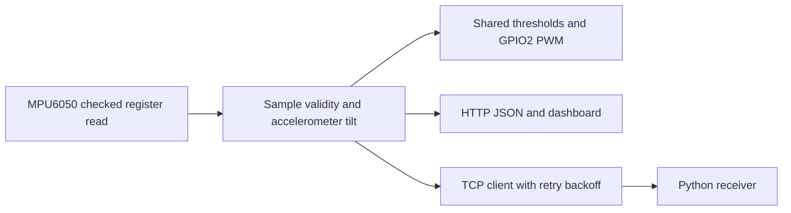

# Wearable Posture Sensing

衣服に取り付けた ESP8266 / MPU6050 試作機の資料と、後年整備した傾斜角・LED・通信ファームウェアです。実物資料、授業のスケッチ、2026 年の統合版を区別しており、ビルド成功を当時の実機動作の証明とはしていません。

[简体中文](README.md) · [English](README_EN.md) · **日本語**

[Technical notes](docs/technical-notes.ja.md) · [Setup](docs/setup.ja.md)

## 資料と実装範囲

| 資料 | 確認できる内容 | 範囲 |
| --- | --- | --- |
| 実物写真 | ESP-12F 円形基板、MPU6050、衣服への取り付け | 材料性能、独自 PCB 設計、角度精度は未確認 |
| 授業の 3 スケッチ | 点滅、線形 PWM、Wi-Fi/IMU 初期化と挨拶送信 | 2026-10-23 に誤記、PWM 設定、接続処理を修正。完全な姿勢システムではない |
| 統合版 | 加速度による傾斜推定、共通閾値、LED、HTTP、TCP | 初回登録は 2026-09-15。今回の保守は 2024 年の導入を証明しない |

## データフロー



## 主な実装

- GPIO4/5 のソフトウェア TWI で 400 kHz を要求し、IMU の 14 バイト読み取りを検査。障害後は 2 s 間隔で再初期化。
- LED と画面はピッチ絶対値 >30° またはロール絶対値 >35° を共用。無効データでは消灯し、利用不可を表示。
- GPIO2 の負論理 PWM は範囲を制限し、モード変更時にリセット。通常 25 ms 刻み、警告は 50 ms ごとに反転。
- AP+STA、HTTP 画面、有効性と経過時間を含む JSON。取得完了から 200 ms 後に再取得し、失敗時は正常表示を解除。
- TCP は有効サンプルのみ最短 100 ms 間隔で送信を試み、再接続は 2 s 間隔。Python 受信ツールを同梱。

## 服飾試作機


## 構成と再現

```text
src/firmware/
  wearable_posture_node.ino
  posture_logic.h
  network_config.example.h
  examples/                    # separate sketches + tcp_config.example.h
tools/telemetry_receiver.py
tests/
docs/                          # images, technical-notes.*, setup.*
```

[Setup](docs/setup.ja.md)

## 検証と限界

2026-10-23 に ESP8266 core 3.1.2 / MPU6050 1.4.5 で統合版と 3 例程を個別にビルドしました。フィードバック 7 件、模擬ブラウザー 7 件、パーサー 3 件が成功。書き込み、実 IMU、無線通信、周期、消費電力、人体での角度精度は未測定です。依存ライブラリのマクロ再定義警告は残ります。

傾斜推定は加速度のみで、センサーフュージョン、ヨー角/軌跡、ひずみ計測、医療診断はありません。校正、実機での障害復帰、時間測定が次の課題です。個人とチームの担当、当時のファームウェア、材料・電源構成は原資料での確認が必要です。コードの許諾は [LICENSE](LICENSE) を参照し、第三者の画像・部品資料には自動適用しません。
