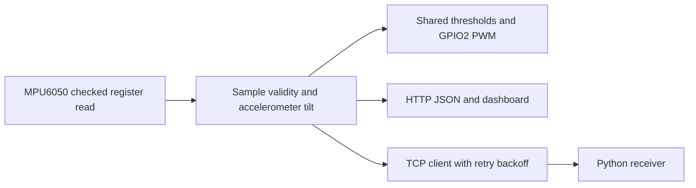

# Wearable Posture Sensing

ESP8266 / MPU6050 服饰原型与后续倾角、LED 和网络遥测固件。历史实物、课程例程和 2026 年集成固件分别归档；编译通过不等于确认当年的烧录版本。

**简体中文** · [English](README.md) · [日本語](README_JA.md)

[Technical notes](docs/technical-notes.zh-CN.md) · [Setup](docs/setup.zh-CN.md)

## 资料与实现范围

| 材料 | 可确认内容 | 边界 |
| --- | --- | --- |
| 实物照片 | ESP-12F 圆形节点、MPU6050 与服饰安装 | 不证明材料性能、PCB 自主设计或角度精度 |
| 三个课程例程 | 点灯、线性 PWM、Wi-Fi/IMU 初始化与问候报文 | 2026-10-23 修正拼写、PWM 配置和连接逻辑；不是完整姿态系统 |
| 综合固件 | 加速度倾角、统一阈值、LED、HTTP、TCP | 首次入库 2026-09-15；本轮维护不证明 2024 年已经部署 |

## 数据流



## 已实现的软件

- GPIO4/5 软件 TWI，400 kHz 请求时钟；校验 14 字节 IMU 读取长度，故障后 2 s 重试。
- LED 与网页共用俯仰绝对值 >30° 或横滚绝对值 >35°；数据无效时熄灯并显示不可用。
- 低有效 GPIO2 PWM，状态切换复位并钳位；正常 25 ms 步进、报警 50 ms 翻转。
- AP+STA、HTTP 页面及带有效性/样本年龄的 JSON；轮询完成后等待 200 ms，失败不保留正常状态。
- TCP 有效样本发送间隔至少 100 ms，重连退避 2 s；附带 Python 接收器。

## 服饰原型


## 目录与复现

```text
src/firmware/
  wearable_posture_node.ino
  posture_logic.h
  network_config.example.h
  examples/                    # separate sketches + tcp_config.example.h
tools/telemetry_receiver.py
tests/
docs/                          # images, technical-notes.*, setup.*
```

[Setup](docs/setup.zh-CN.md)

## 验证与局限

2026-10-23：综合固件及三个独立例程在 ESP8266 core 3.1.2、MPU6050 1.4.5 下编译通过；7 项反馈逻辑、7 项浏览器模拟和 3 项报文解析测试通过。未烧录、未验证实体 IMU、无线链路、频率、功耗或人体角度准确率。库宏重定义警告仍存在。

倾角仅使用加速度计；没有姿态融合、航向/轨迹、应变采集或医学诊断。下一步是标定、实体故障恢复和计时测量。个人与团队确切分工、当年固件及硬件材料/电源仍待原始记录确认。代码许可见 [LICENSE](LICENSE)，不自动转授第三方图片或器件资料。
