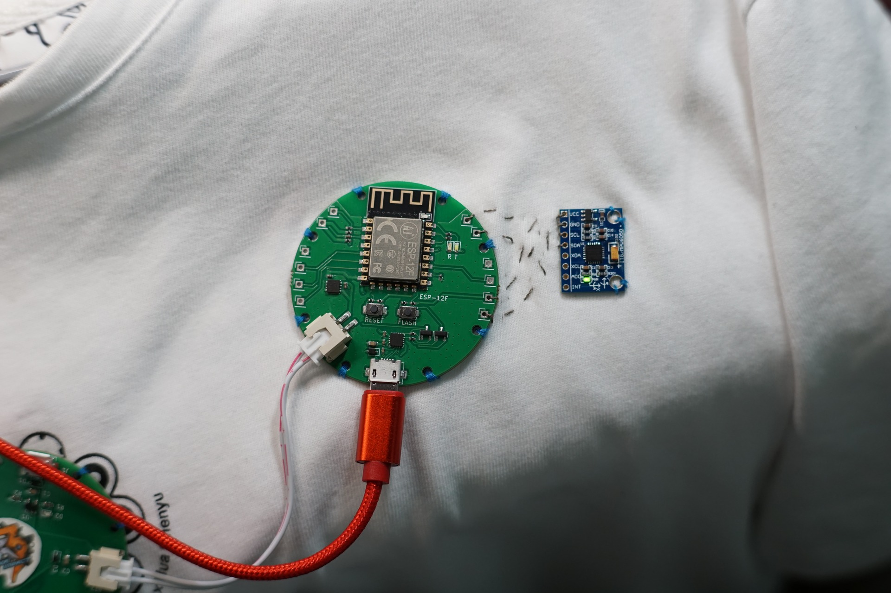
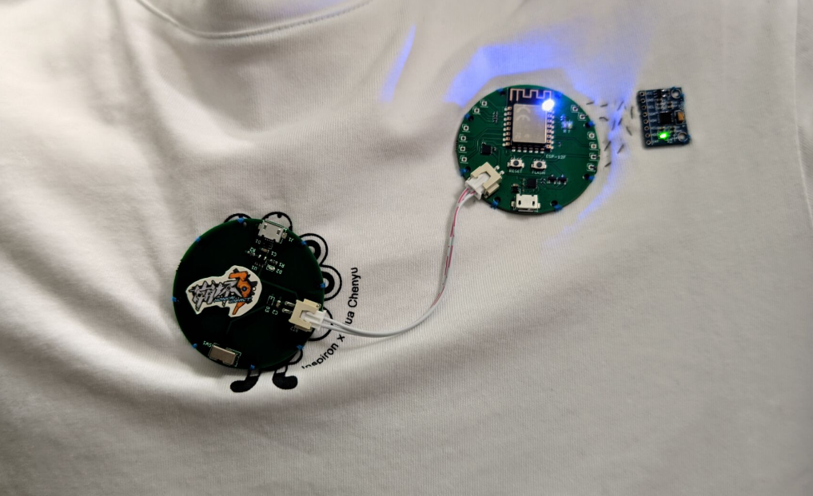

# Wearable Posture Sensing — Technical notes

[简体中文](technical-notes.zh-CN.md) · **English** · [日本語](technical-notes.ja.md) · [Overview](../README_EN.md)

<a id="versions"></a>

## Original sketches versus integrated firmware

| File | Actual logic | Gap |
| --- | --- | --- |
| [Blink](../src/firmware/examples/sketch_mar12a1_blink.ino) | Intended GPIO2 high/low intervals of 2 s each | Misspelled `pinMod` prevents compilation as written |
| [PWM](../src/firmware/examples/sketch_mar19a2_pwm.ino) | Linear 0–255 ramps, step 5, delay 30 ms | No explicit `pinMode` or PWM-range configuration; no nonlinear correction |
| [TCP/IMU](../src/firmware/examples/sketch_mar26a_tcp_imu.ino) | Wait for STA connection, initialize MPU6050, attempt text I/O | No `client.connect()` or motion read; unused loopback host; serial changes from 115200 to 38400 |
| [Integrated firmware](../src/firmware/wearable_posture_node.ino) | Acquisition, tilt, PWM, HTTP, TCP client | Later archived implementation, not matched to the original demonstration |

All three examples are byte-identical to their corresponding local course `.ino` files. The integrated firmware first appears in commit `a353b67` on 2026-09-15 and is absent from those original sketches. Its addition date and “production” wording in comments do not establish historical deployment.

<a id="sensing"></a>

## Acquisition and equations

```math
\theta=\mathrm{atan2}(-a_x,\sqrt{a_y^2+a_z^2})\frac{180}{\pi},\quad
\phi=\mathrm{atan2}(a_y,a_z)\frac{180}{\pi}
```

```math
\lVert\mathbf a\rVert=\sqrt{a_x^2+a_y^2+a_z^2},\qquad a_i=\frac{\mathrm{raw}_i}{16384}
```

`updateKinematics()` reads six `int16_t` values using `getMotion6()` and divides acceleration by 16384. The compiled MPU6050 1.4.5 library initializes ±2g and ±250°/s ranges by default; the sketch does not explicitly calibrate offsets. `atan2` results are in degrees. Acceleration magnitude includes gravity and is not an energy integral.

`raw_gx/raw_gy/raw_gz`, integration time, and a fusion state are unused. There is no DMP/FIFO sampling, yaw, velocity/position reconstruction, or motion-based alarm suppression. Quasi-static assumptions, mounting, offsets, and dynamic acceleration affect tilt. Sensor resolution, decimal formatting, and display precision are not system angle accuracy.

`Wire.begin(4,5)` and `Wire.setClock(400000)` configure the interface. ESP8266 core `Wire` uses software TWI rather than an independent hardware I2C controller; signal quality has not been measured. Failed IMU self-test only prints a warning, without the reinitialization retry suggested by the comment or a valid-data gate.

<a id="feedback"></a>

## Thresholds, PWM, and timing

| Path | Actual rule or interval |
| --- | --- |
| Firmware LED | `abs(pitch) > 30` only; roll ignored |
| Browser badge | `abs(pitch) > 30` or `abs(roll) > 35` |
| PWM update | 25 ms check; normal steps ±5 near endpoints 5/1020; output `1023-pwm_val` |
| Alert | Toggle between 0 and 1023 each update; ideally about 20 Hz, not the comment's 10 Hz |
| TCP | 100 ms check, nominally at most about ten sends/s; connection/HTTP work can delay it |
| Browser/main loop | 200 ms browser timer; firmware also calls `delay(10)`, not a fixed 100 Hz sampler |

Normal brightness is a linear triangular ramp with a source-derived period near 10.15 s, not a 3 s sine/Gamma-2.2/Weber-law controller. Mode transitions do not reset or fully clamp PWM state, allowing endpoint excursions. There is no hysteresis, duration requirement, or motion gate. Roll can trigger the browser while leaving the LED unalerted. These are current behavior gaps; this documentation revision does not change them.

<a id="network"></a>

## Networking, page, and packet format

`setup()` selects AP+STA and HTTP port 80, registering only GET `/` and GET `/api/data`. JSON fields are `pitch`, `roll`, and `accel`. Firmware formats two decimal places; the page shows one for angles and two for magnitude. No remote LED toggle, threshold setting, cloud service, or app-control route exists.

`streamTelemetry()` reconnects through blocking `WiFiClient.connect` to configured `192.168.4.2:8080`, then sends newline-terminated text below. A receiver is not included. There is no application acknowledgment, timestamp, sequence number, or receiver feedback.

```text
PKT:P=<pitch>,R=<roll>,A=<acceleration_in_g>

```

The default AP gateway is usually `192.168.4.1`; use the printed `softAPIP()` value. Historical `192.168.147.81` screenshots do not define this AP address. The integrated sketch's 115200-baud serial output logs initialization, not continuous three-axis samples. Repeated connection failure can delay all single-threaded tasks. Configure credentials for your network; the STA password is not repeated here.

<a id="hardware"></a>

## Hardware evidence and open questions





Photos support the ESP-12F circular node, MPU6050 module, and stitched mounting. They do not establish silver versus stainless yarn, diameter/resistivity, washability, reliability, or production readiness. Conductive thread is not connected to an ADC/bridge acquisition path and is not an implemented strain sensor.

Editable schematics, PCB projects, a BOM, and power measurements are absent. Component images/course circuits are references, not proof of TP4054/SGM2019, an 800 mAh battery, a particular charge current, complete protection, or runtime in this unit. GPIO2 is the source-configured active-low LED output; external LED/power wiring needs board verification. The old 6DOF trajectory and fusion diagrams do not document the current algorithm.

Course-team context is retained without attributing all hardware/software design to one person from unmatched material. Exact ownership, deployed firmware, and measurement records remain open.
